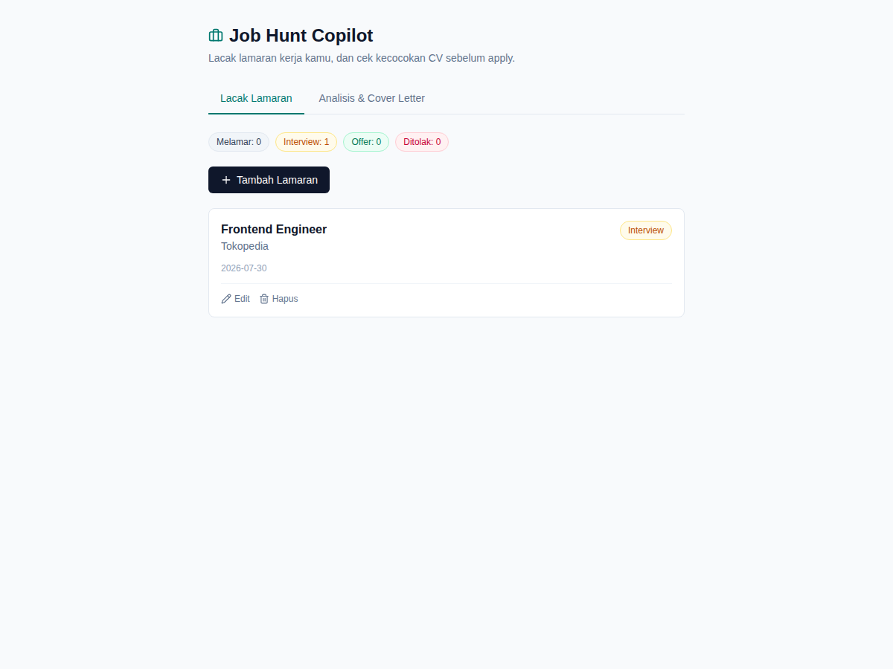
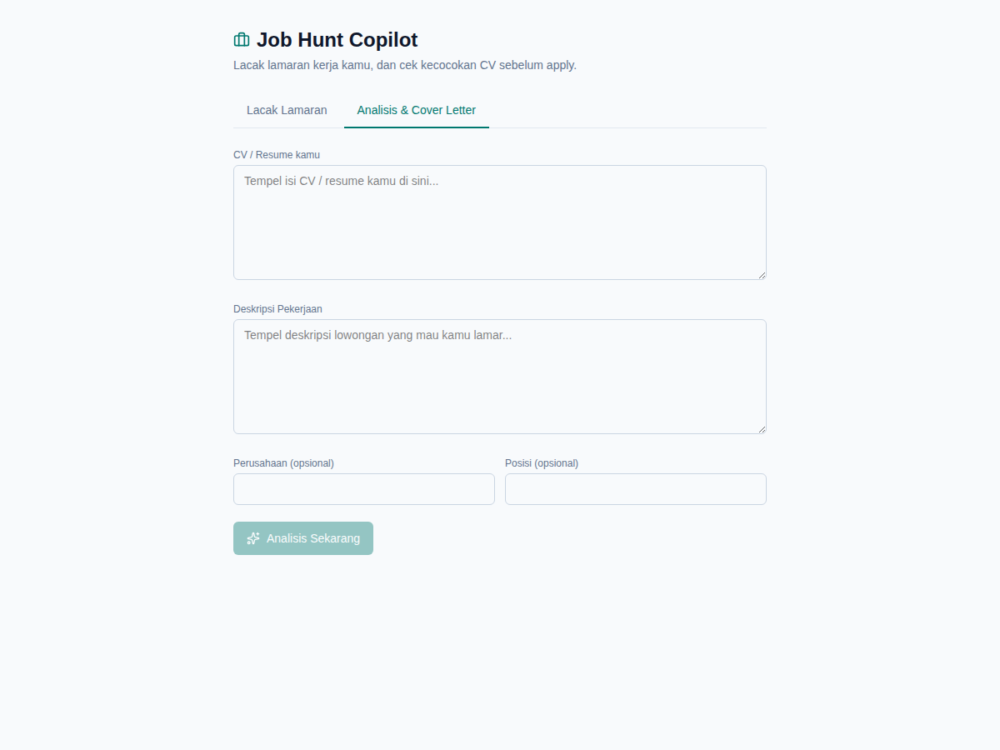

# Job Hunt Copilot


> Ganti `USERNAME` di badge CI di atas dengan username GitHub kamu setelah push.

Aplikasi pelacak lamaran kerja dengan asisten AI yang menganalisis kecocokan CV terhadap deskripsi pekerjaan dan membuat draft cover letter otomatis.




## Fitur

- Lacak lamaran kerja (perusahaan, posisi, status, tanggal, catatan)
- Analisis kecocokan CV vs deskripsi pekerjaan (skor 0–100, kekuatan, kekurangan)
- Draft cover letter otomatis berbasis AI
- Data tersimpan di browser (`localStorage`) — tidak perlu database untuk mulai

## Tech Stack

- Next.js 16 (App Router, Route Handlers, Turbopack)
- React 19
- Tailwind CSS v4
- Gemini API (Google) untuk analisis & generasi teks — gratis, tanpa kartu kredit
- ESLint 9 (flat config) + Prettier

## Menjalankan secara lokal

1. Install dependencies:

   ```bash
   npm install
   ```

2. Salin `.env.example` menjadi `.env.local`, lalu isi dengan API key kamu:

   ```
   GEMINI_API_KEY=AIza...
   ```

   Dapatkan API key gratis (tanpa kartu kredit) di [aistudio.google.com](https://aistudio.google.com) → tombol **Get API key**.

3. Jalankan server development:

   ```bash
   npm run dev
   ```

4. Buka `http://localhost:3000`

### Perintah lain

```bash
npm run lint          # cek kode dengan ESLint
npm run lint:fix      # otomatis perbaiki yang bisa diperbaiki
npm run format        # format semua file dengan Prettier
npm run format:check  # cek format tanpa mengubah file (dipakai CI)
npm run build          # build production
```

## Deploy ke Vercel

1. Push project ini ke repo GitHub.
2. Buka [vercel.com](https://vercel.com) → **Add New Project** → import repo GitHub kamu.
3. Sebelum deploy, buka tab **Environment Variables**, tambahkan:
   - Key: `GEMINI_API_KEY`
   - Value: API key kamu dari aistudio.google.com
4. Klik **Deploy**. Vercel otomatis build dan memberi link live-nya.

## Cara Kerja

Permintaan analisis dari browser dikirim ke `/api/analyze` (Route Handler di server Next.js), bukan langsung ke Gemini API. Route Handler inilah yang menyimpan dan memakai `GEMINI_API_KEY`, sehingga API key tidak pernah terekspos ke browser pengguna.

```
Browser  --(CV + deskripsi kerjaan)-->  /api/analyze  --(pakai GEMINI_API_KEY)-->  Gemini API
Browser  <---------(hasil analisis JSON: skor, kekuatan, gap, cover letter)---------
```

## Struktur Project

```
app/
  layout.js               root layout + metadata
  page.js                  halaman utama
  globals.css               import Tailwind
  icon.svg                   favicon
  api/analyze/route.js       proxy server-side ke Gemini API
components/
  JobHuntCopilot.jsx          shell utama (header + tab switcher)
  Tracker.jsx                  tab pelacak lamaran
  Analyzer.jsx                  tab analisis & cover letter
  ApplicationForm.jsx            form tambah/edit lamaran
  ApplicationList.jsx             daftar lamaran
  StatusBadge.jsx                   badge status berwarna
lib/
  constants.js               opsi status, style, konstanta UI
  utils.js                     helper murni (id, tanggal, warna skor)
  storage.js                    wrapper localStorage
.github/workflows/ci.yml   lint + build otomatis tiap push
```

## Catatan

Data lamaran & CV disimpan di `localStorage` browser, jadi bersifat per-device dan tidak dibagikan ke siapa pun. Langkah lanjutan yang bisa ditambahkan: database (Postgres/Prisma) supaya data bisa diakses dari beberapa perangkat, autentikasi, atau unit test untuk `lib/`.

## Lisensi

MIT — lihat [LICENSE](./LICENSE).
